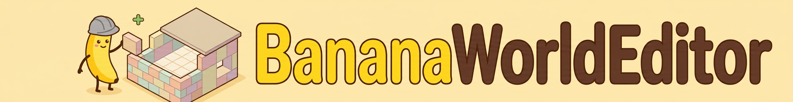
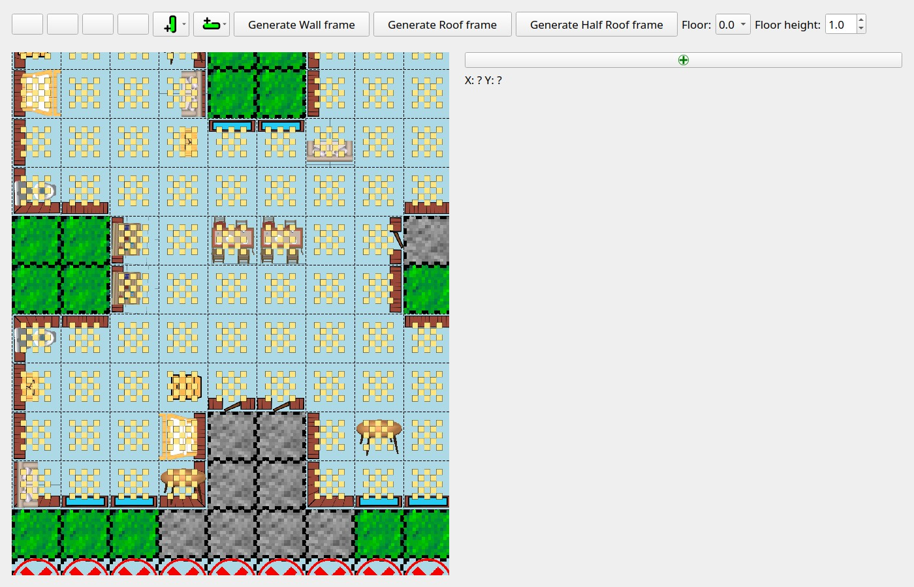
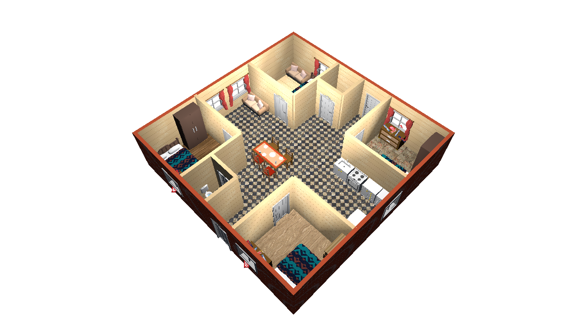
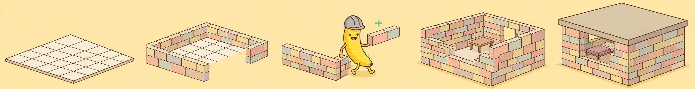

# BananaWorldEditor


Universal map editor for 3D games.

- **Terrain editor** — visual grid editing for outdoor maps
- **House editor** — walls, roofs, furniture, interiors
- **Headless CLI** (`bwe_cli.py`) — same model layer as the GUI, for
  scripts and AI harnesses

## Story

A friend and I once set out to build a 3D game. We opened Unity, and for
the first three days we were amazed at how simple it was and how limitless
the possibilities seemed.

Then we started building the game itself: each of us was to model a few
old wooden houses in Blender. It looked easy — 15 minutes per house. But
after two days on a single house that was still half-finished, I suddenly
realized how much work it really was. With only 1–2 hours after work for
such a hobby, we would not finish our game even in years.

This is a typical beginner's mistake — one that has drained the enthusiasm
of many would-be game makers and killed a lot of outstanding projects.

So I decided to make a tool that lets me build maps easily from ready-made
blocks — a 2D editor for a 3D world, since 3D positioning eats up too
much time too.

## Features

- **Plugin system** — plugins automatically generate terrain, randomly
  arrange trees, and more. They automate the routine work that takes most
  of the time.
- **External objects support** — connect a directory with your game's
  private objects and textures, keeping them separate from the editor's
  built-in content.
- **Floor-by-floor editing** — a 2D house is edited one floor at a time.

# Status
Both editors (terrain and house) are implemented, plus the headless CLI
driving the same model layer.

Warning: Project is not finished. Interfaces and file format can be changed in the future.

Future plans: see [ROADMAP.md](ROADMAP.md).

# Map example



## Installation

The editor is installed and run with [uv](https://docs.astral.sh/uv/) —
uv replaces pip, and `requirements.txt` no longer exists: dependencies are
declared in `pyproject.toml` and pinned in `uv.lock`.

To install and use **BananaWorldEditor**, follow these steps:

1. Install uv with the official installer:

    ```bash
    curl -LsSf https://astral.sh/uv/install.sh | sh
    ```

2. Clone the repository:

    ```bash
    git clone https://github.com/vitperov/BananaWorldEditor.git
    cd BananaWorldEditor
    ```

3. Create the environment and install the dependencies:

    ```bash
    uv sync
    ```

4. Run from the editor root — the editor:

    ```bash
    uv run BananaWorldEditor.py
    ```

    and the headless CLI:

    ```bash
    uv run bwe_cli.py <command>
    ```

The CLI can also be run from a different working directory (map-file
arguments still resolve against your current directory) — point uv at the
project and give the path to the script:

```bash
uv run --project <path-to-BananaWorldEditor> <path-to-BananaWorldEditor>/bwe_cli.py <command>
```

## License

MIT — see [LICENSE](LICENSE). Copyright (c) 2022-2026 Vitaly Perov.




